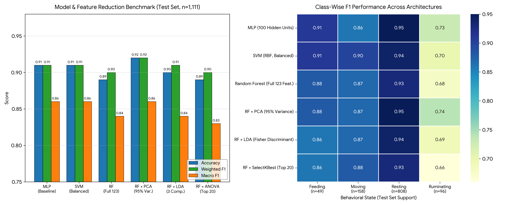

# Wearable Accelerometer Activity Recognition & High-Dimensional Feature Reduction

[](https://colab.research.google.com/github/shuvroditcl/livestock-accelerometer-activity-recognition/blob/main/notebooks/Inertial_Sensor_Behavior_Classification_Pipeline.ipynb)
[](https://www.python.org/downloads/)
[](https://scikit-learn.org/)
[](https://zenodo.org/records/5849025)
[](https://opensource.org/licenses/MIT)

## Overview

Inertial Measurement Units (IMUs) and wearable tri-axial accelerometers provide a non-invasive, low-power mechanism for continuous Behavioral Identification in Domestic Animals (BIDA) and precision agriculture telemetry. However, high-frequency sensor streams introduce three classic machine learning challenges:
1. **Temporal Autocorrelation & Data Leakage:** Consecutive sensor windows from the same recording session share near-identical kinematic signatures.
2. **Severe Class Skew:** Natural behavioral distributions are heavily dominated by sedentary states (`resting` > 55%) while critical physiological states (`feeding` ~ 6.5%) are rare.
3. **High-Dimensional Multicollinearity:** Engineered time- and frequency-domain statistics (e.g., axis means, sums, spectral power, and Overall Dynamic Body Acceleration) exhibit severe linear redundancy.

This project implements a leakage-free **Time-Series Feature Engineering, Dimensionality Reduction, and Multi-Classifier Benchmarking Pipeline** on the **Japanese Black Beef Cow Tri-Axial Accelerometer Dataset** (25Hz neck-mounted Kionix KX122-1037 sensor, 11,319 windows, 123 engineered features). By combining **Principal Component Analysis (`PCA`)** with **Random Forest**, the pipeline eliminates 46 collinear feature pairs ($\vert{}r\vert{} > 0.90$) and achieves **92.0% Test Accuracy (0.92 Weighted F1, 0.86 Macro F1)**.

---

## Dataset & Telemetry Architecture

The dataset ([Zenodo Record 5849025](https://zenodo.org/records/5849025)) comprises **11,319 labeled time-series windows** across **126 columns** collected at 25Hz ($\pm 2g$, 16-bit resolution) from six subjects (`Cow 01`–`Cow 06`):
* **123 Input Features:** Tri-axial ($X, Y, Z$) time-domain and frequency-domain descriptors including axis means (`acc_x_mean`), cumulative sums (`acc_x_sum`), standard deviations, skewness, spectral entropy, and Overall Dynamic Body Acceleration (`odba`).
* **Grouping & Metadata (`session`, `animal`):** Identifies consecutive temporal recording blocks and individual subjects.
* **Target Taxonomy (`behavior` — 4 Classes):**

| Behavioral State | Global Share | Test Set Support ($n=1,111$) | Kinematic Profile |
| :--- | :---: | :---: | :--- |
| **`resting`** | ~55.7% | 808 (72.7%) | Low variance across $X, Y, Z$ axes; minimal dynamic body acceleration (`odba`). |
| **`ruminating`** | ~19.4% | 96 (8.6%) | Subtle, rhythmic neck micro-oscillations combined with stationary posture. |
| **`moving`** | ~18.4% | 158 (14.2%) | High-amplitude multi-axis acceleration spikes and elevated spectral energy. |
| **`feeding`** | ~6.5% | 49 (4.4%) | Downward pitch orientation ($X/Y$ mean shift) with periodic grazing jaw movements. |

*(Note: Individual subject distributions vary substantially—e.g., Subject 1 rests ~76% of the time with <4% rumination, whereas Subject 4 moves ~33% of the time and Subject 6 feeds 23% of the time—necessitating robust cross-session generalization).*

---

## Pipeline Engineering & Methodology

### 1. Leakage-Free Temporal Splitting (`GroupShuffleSplit`)
Standard random splitting on consecutive 25Hz sensor windows causes severe temporal data leakage, placing adjacent milliseconds of the same physical movement into both training and test sets. To enforce strict evaluation integrity, a two-stage **`GroupShuffleSplit` grouped by `session`** (`random_state=42`) isolates continuous recording sessions entirely into distinct partitions:
* **Training Partition:** `8,745` windows (77.3%)
* **Validation Partition:** `1,463` windows (12.9%)
* **Held-Out Test Partition:** `1,111` windows (9.8%)

### 2. Zero-Leakage Feature Standardization (`StandardScaler`)
Because the 123 features span incompatible numerical magnitudes—for example, `acc_x_sum` exhibits a training mean of `-1.8837` ($\sigma = 4.0297$) whereas `odba` exhibits a mean of `0.0729` ($\sigma = 0.0870$)—unscaled features distort gradient updates in neural networks (`MLP`) and Euclidean distance kernels in `SVM`. A `StandardScaler` is fit strictly on `X_train` ($\mu = 0.0, \sigma = 1.0$) and applied to validation and test splits.

### 3. Imbalance Mitigation (`compute_class_weight`)
To prevent classifiers from collapsing into majority-class predictors (`resting`), balanced inverse-frequency class weights are computed from the training distribution (`compute_class_weight('balanced')`) and injected directly into the loss functions of the `SVC` and `RandomForestClassifier` estimators.

### 4. Collinearity Diagnosis & Dimensionality Reduction
Pairwise Pearson correlation analysis across the 123 training features revealed **46 highly collinear features with $\vert{}r\vert{} > 0.90$** (over 160 correlated feature pairs, such as `acc_x_mean` vs. `acc_x_sum` which share identical standardized values). Three reduction strategies were benchmarked against the full 123-feature space:
* **Principal Component Analysis (`PCA`, `n_components=0.95`):** Unsupervised orthogonal projection retaining 95% of total sensor variance while stripping collinear noise.
* **Fisher's Linear Discriminant Analysis (`LDA`):** Supervised projection maximizing between-class scatter relative to within-class scatter across $C - 1 = 3$ discriminant axes.
* **Univariate ANOVA F-Test Selection (`SelectKBest`, `f_classif`, `k=20`):** Retains only the top 20 individual sensor features with the highest discriminative $F$-statistics.

---

## Experimental Results & Benchmark Analysis

All six model and dimensionality-reduction configurations were evaluated on the held-out `1,111`-sample test set:

| Model Architecture / Feature Pipeline | Test Accuracy | Weighted F1 | Macro F1 | Macro Precision | Macro Recall | `feeding` F1 ($n=49$) | `moving` F1 ($n=158$) | `resting` F1 ($n=808$) | `ruminating` F1 ($n=96$) |
| :--- | :---: | :---: | :---: | :---: | :---: | :---: | :---: | :---: | :---: |
| **MLP (`100` Hidden Units, ReLU, Adam)** | 0.91 | 0.91 | **0.86** | 0.84 | 0.90 | **0.91** | 0.86 | **0.95** | 0.73 |
| **SVM (RBF Kernel, Balanced Weights)** | 0.91 | 0.91 | **0.86** | 0.83 | **0.92** | **0.91** | **0.90** | 0.94 | 0.70 |
| **Random Forest (Full 123 Features)** | 0.89 | 0.90 | 0.84 | 0.81 | 0.89 | 0.88 | 0.87 | 0.93 | 0.68 |
| **Random Forest + PCA (95% Variance)** | **0.92** | **0.92** | **0.86** | **0.85** | 0.87 | 0.88 | 0.87 | **0.95** | **0.74** |
| **Random Forest + LDA (3 Discriminants)** | 0.90 | 0.91 | 0.84 | 0.81 | 0.88 | 0.86 | 0.87 | 0.94 | 0.69 |
| **Random Forest + SelectKBest (Top 20)** | 0.89 | 0.90 | 0.83 | 0.80 | 0.90 | 0.86 | 0.88 | 0.93 | 0.66 |
| **Benchmark Mean $\pm$ Std** | **0.903 $\pm$ 0.012** | **0.908 $\pm$ 0.008** | **0.848 $\pm$ 0.013** | **0.823 $\pm$ 0.020** | **0.893 $\pm$ 0.018** | **0.883 $\pm$ 0.023** | **0.875 $\pm$ 0.014** | **0.940 $\pm$ 0.009** | **0.700 $\pm$ 0.030** |

### Visual Performance Benchmark



### Key Engineering Insights
1. **PCA De-Noising Boosts Random Forest (+3.0% Accuracy, +6.0% `ruminating` F1):** On the raw 123-feature space, Random Forest achieved 0.89 accuracy (`0.68` F1 on `ruminating`) because 46 collinear features diluted feature-sampling diversity during node splitting. Orthogonalizing the feature space via **PCA (95% variance)** elevated Random Forest to the highest overall performance across all models (**92.0% Accuracy, 0.92 Weighted F1, 0.74 `ruminating` F1**).
2. **84% Feature Compression via `SelectKBest` with Zero Accuracy Loss:** Pruning 103 features and retaining only the **Top 20 ANOVA F-test features** matched the full 123-feature Random Forest baseline (`0.89` Accuracy, `0.90` Weighted F1) while drastically reducing memory footprint and inference latency for edge/collar deployment.
3. **Minority Class Resilience (`feeding`):** Despite representing only 4.4% of the test set ($n=49$), both **MLP** and **Balanced RBF-SVM** achieved **0.91 F1 (0.94 Recall)** on `feeding`, proving that standardized spectral/postural features combined with inverse-frequency weighting effectively isolate grazing kinematics.
4. **Regularization & Complexity Trade-Offs:** For `MLP`, tuning $L_2$ weight decay within $\alpha \in [10^{-4}, 10^{-2}]$ balances decision boundary smoothness against sensor noise overfitting. While `RBF-SVM` achieves strong recall (`0.92` Macro Recall), its training complexity scales between $\mathcal{O}(n_{\text{features}} \cdot n_{\text{samples}}^2)$ and $\mathcal{O}(n_{\text{features}} \cdot n_{\text{samples}}^3)$, making `Random Forest + PCA` or `SelectKBest` superior for scalable edge telemetry.

---

## Repository Structure

```text
livestock-accelerometer-activity-recognition/
├── notebooks/
│   └── Inertial_Sensor_Behavior_Classification_Pipeline.ipynb  # End-to-end sensor ML pipeline
├── results/
│   ├── sensor_classification_benchmarks.csv                    # Summary metrics across all 6 models
│   └── model_benchmark_comparison.png                          # High-res dual-panel benchmark visual
├── .gitignore                                                  # Standard Python exclusions
├── requirements.txt                                            # Pinned scikit-learn & data stack
├── LICENSE                                                     # MIT License
└── README.md                                                   # Architectural documentation & findings
```

## Quickstart
Download Dataset: Obtain cow_accelerometer_data.xlsx from Zenodo Record 5849025.

Install Dependencies & Execute:

```Bash
git clone [https://github.com/](https://github.com/)shuvroditcl/livestock-accelerometer-activity-recognition.git
cd livestock-accelerometer-activity-recognition
pip install -r requirements.txt
jupyter notebook notebooks/Inertial_Sensor_Behavior_Classification_Pipeline.ipynb
```

## References
Chawla, N. V., et al. (2002). SMOTE: Synthetic Minority Over-sampling Technique. Journal of Artificial Intelligence Research, 16, 321–357.

Pedregosa, F., et al. (2011). Scikit-learn: Machine Learning in Python. Journal of Machine Learning Research, 12, 2825–2830.

Riaboff, L., et al. (2022). Japanese Black Beef Cow Behavior Classification Dataset. Zenodo. https://doi.org/10.5281/zenodo.5849025


**Author**<br>
Subrota Debnath<br>
Master of Information Sciences<br>
Massey University
